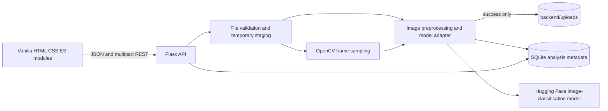

# TruthLens AI

TruthLens AI is a local-first educational web application for transparently screening images and selected video frames for authenticity indicators. It provides a responsive, multi-page vanilla-JavaScript frontend, a Flask API, and SQLite analysis metadata.

> **Important:** The reviewed `Organika/sdxl-detector` candidate is configured by default for this educational project. It is an SDXL-focused screening model, not a universal authenticity detector, and its CC BY-NC 3.0 license restricts use to non-commercial contexts. Install the AI dependencies below for real inference. Set `TRUTHLENS_MODEL_VERIFIED=false` to disable it. The application never fabricates a prediction.

## Features

- Image upload screening for JPG, JPEG, and PNG, with signature, MIME, size, dimension, and decode checks.
- MP4 screening with bounded duration, dimensions, decode count, and up to eight sampled frames.
- Transparent frame-based video aggregation using the mean of per-frame AI-label scores and a majority of per-frame top labels. No temporal, audio, or lip-sync analysis is performed.
- SQLite analysis history, deletion, dashboard counts, processing duration, model metadata, and references to retained media.
- Successfully analyzed uploads are retained locally until their history record is deleted or an administrator removes the file. The SQLite database stores metadata and results, not media bytes.
- Responsive interface, keyboard-visible focus, reduced-motion support, and honest unavailable/error states.
- Hugging Face image-classification adapter for the reviewed, pinned SDXL detector.

## Architecture



Video scores are the arithmetic mean of sampled-frame AI-label scores. The video category indicates whether a strict majority of sampled frames' top labels correspond to configured AI-generated labels; otherwise it reports that no majority was detected. These are screening signals, not calibrated probabilities or definitive authenticity verdicts.

## Folder structure

```text
.
├── backend/
│   ├── ai/                 # Startup-loaded model adapter
│   ├── database/           # SQLite schema and repository
│   ├── routes/             # Health, detection, history and dashboard endpoints
│   ├── services/           # Image and video processing
│   ├── tests/              # Flask test-client and service tests
│   ├── utils/              # Validation, errors and safe display names
│   ├── app.py
│   └── config.py
├── frontend/
│   ├── css/                # Design tokens, base, components, pages, responsive
│   ├── js/                 # API client and page modules
│   └── *.html              # Landing, dashboard, image/video, result, history, about
├── .env.example
├── requirements.txt
├── requirements-ai.txt    # PyTorch and Transformers inference dependencies
└── backend/uploads/       # Private local media store; ignored by Git
```

## Prerequisites

- Windows 10/11 (commands below use PowerShell).
- Python 3.14 on Windows for the AI-enabled application. PyTorch currently has no Windows wheel for the Python 3.15 prerelease in this environment.
- Internet access for installing Python packages and downloading the pinned 347 MB Hugging Face model on first startup.
- Sufficient disk space and RAM for PyTorch and model inference. CPU inference is supported; GPU is not required.

## Run locally on Windows

From the project root, create the Python 3.14 virtual environment and install the core and AI inference dependencies:

```powershell
py -3.14 -m venv .venv-ai
.\.venv-ai\Scripts\python.exe -m pip install --upgrade pip
.\.venv-ai\Scripts\python.exe -m pip install -r requirements.txt -r requirements-ai.txt
```

Start the complete application from the project root:

```powershell
.\.venv-ai\Scripts\python.exe -m backend.app
```

The Flask server listens only on `127.0.0.1:5000` and serves the existing frontend at <http://127.0.0.1:5000/>. The API remains under `/api` (for example, <http://127.0.0.1:5000/api/health>); the frontend's configured API base URL is `http://127.0.0.1:5000/api`. The default CORS allowlist includes the backend's own `localhost` and `127.0.0.1` origins so browser module scripts load when the frontend is served by Flask.

Alternatively, to serve the frontend separately with VS Code Live Server, open `frontend\index.html` in VS Code and select **Go Live**. Open the Live Server URL (normally <http://127.0.0.1:5500/>). The default CORS configuration allows `localhost` and `127.0.0.1` on port 5500. Keep the Flask backend running in its own terminal; if Live Server uses another port, add that origin to `TRUTHLENS_CORS_ORIGINS` before starting Flask.

The equivalent standalone static server command, if you do not use Live Server, is:

```powershell
python -m http.server 5500 --directory frontend
```

Open <http://127.0.0.1:5500/>. The API allows the local frontend origins on ports 5500 and 8000 by default. Do not expose the development server to an untrusted network.

The SQLite database is initialized at `backend\truthlens.sqlite3`; its additive startup migration preserves existing records and adds a nullable `media_filename` field. Existing history is not deleted, but old records have no stored media and therefore cannot be previewed.

Successfully analyzed image/video files are stored under `backend\uploads\` by default with a random generated filename. Set `TRUTHLENS_UPLOAD_DIR` to use another local directory. Image uploads are limited to 10 MB by default, video uploads to 50 MB, and `TRUTHLENS_MAX_UPLOAD_BYTES` sets the shared upper bound (50 MB by default); optional `TRUTHLENS_IMAGE_MAX_BYTES` and `TRUTHLENS_VIDEO_MAX_BYTES` values can lower their respective per-format limits. Flask also limits request bodies to the shared cap plus multipart overhead. The upload directory is not served as a static folder: previews are returned only through `/api/media/<analysis_id>`, which resolves the filename stored for that database record and supports HTTP range requests for video playback.

Invalid uploads are not retained: extension, MIME, size, signature and basic content checks run before permanent storage; any later frame-decode or analysis error removes the stored copy. Analysis failures, including unavailable model inference, retain a failure/unavailable history record where applicable but do not retain the uploaded media. The staging upload is removed after the request; an abrupt process or machine termination could leave a staging temporary file or an unreferenced media file, so review the temporary directory and `backend\uploads\` during manual maintenance. A deletion transaction removes the history row and then the unique media file; a media file shared by another record is preserved. If post-commit filesystem cleanup fails, the orphan is logged for administrator cleanup. If Windows reports the media file is in use, the API keeps the history record and returns a retryable error.

**Retention and privacy:** uploaded media is kept on this machine until you delete its analysis or an administrator removes it. History deletion removes both the record and its media when no other analysis references that file. This is local disk storage, not cloud storage, encryption, or a production backup system. The app binds Flask to `127.0.0.1`; do not expose it or the media API on an untrusted network. There is no user-account authentication in this student project.

**Backup and restore:** stop Flask before making a consistent backup. Copy `backend\truthlens.sqlite3` and the complete configured media directory (`backend\uploads\` by default) together, preserving their directory contents. To restore, stop Flask, restore both the database and media directory to their configured paths, then restart. Restoring only the database leaves media previews missing; restoring only the media directory leaves files unreferenced. Local data persists through normal application restarts, but may be lost if the folder or machine is deleted, damaged, or moved without its database and media directory.

The `.env.example` file is a configuration reference; the application does not load `.env` files automatically. For a custom path or size, set the environment values in the PowerShell session that starts Flask, for example:

```powershell
$env:TRUTHLENS_UPLOAD_DIR = "C:\TruthLensData\uploads"
$env:TRUTHLENS_MAX_UPLOAD_BYTES = "52428800"
.\.venv-ai\Scripts\python.exe -m backend.app
```

## Detector configuration

The configured educational candidate is [Organika/sdxl-detector](https://huggingface.co/Organika/sdxl-detector). Its model card describes a binary image-classification detector fine-tuned for SDXL-generated images versus human images. The pinned config revision [b37fede](https://huggingface.co/Organika/sdxl-detector/commit/b37fede8562cb72b89ec201c0987f96ba21b518a) exposes the exact labels `artificial` and `human`, which are compatible with the adapter's documented image-classification inference interface.

At that revision, the model config is a two-class Swin image classifier and the image processor resizes inputs to 224×224, rescales pixel values, then normalizes using means `[0.485, 0.456, 0.406]` and standard deviations `[0.229, 0.224, 0.225]`. The Transformers image-classification pipeline applies this processor to the RGB image and returns label/score pairs. TruthLens stores the `artificial` class score as its screening score; it is a model output, not a calibrated probability.

This candidate is **not a universal authenticity or deepfake detector**: its card says performance may be lower for models other than SDXL. The pinned model card declares CC BY-NC 3.0 and notes the predecessor used training images scraped from Reddit; use this model only for non-commercial personal or educational purposes and review training-data risks and institutional requirements. The pinned 347 MB checkpoint was downloaded and CPU-smoke-tested in this workspace with Python 3.14.7, PyTorch 2.14.1, and Transformers 4.57.6. That verifies loading and inference only; it is not an accuracy evaluation or evidence of general detector performance. A general image classifier is not automatically an AI-generated-image detector.

The app pins this reviewed model revision and labels by default. Its Transformers model metadata identifies `image-classification`, `SwinForImageClassification`, and `AutoImageProcessor`, so the adapter uses the documented `image-classification` pipeline. The processor resizes RGB input to 224×224 and applies the configured rescaling and ImageNet normalization. The model is loaded once while the Flask app starts; if dependencies are missing or loading fails, Flask remains available, `/api/health` reports the detector as unavailable, and detection returns an explicit error. Set `TRUTHLENS_MODEL_VERIFIED=false` to opt out. Alternative model IDs/revisions require an explicit `TRUTHLENS_MODEL_VERIFIED=true` and matching `TRUTHLENS_AI_LABELS`.

The first launch downloads the pinned 347 MB model checkpoint and processor files if they are not already cached. If weights are missing, inaccessible, incompatible, or inference fails, TruthLens reports the detector unavailable and logs startup/inference details in the backend terminal. The API does not return a fabricated score.

After the backend reports `"available": true` at `/api/health`, upload a JPG or PNG from the frontend or test the endpoint from PowerShell (replace the sample path with a real image):

```powershell
curl.exe -F "file=@C:\path\to\test-image.jpg;type=image/jpeg" http://127.0.0.1:5000/api/detect/image
```

A successful inference returns HTTP 200 with `status: "completed"`, a numeric `score`, and model metadata. If loading or inference fails, inspect the backend terminal and the API's explicit error response. An unavailable record created before configuring the model is not retroactively reprocessed; upload the image again after restarting.

## API

All responses use JSON. Errors have the form `{"error":{"code":"...","message":"..."}}`. Detection responses include the saved analysis record and its `analysis_id`; when model loading or inference is unavailable, the record includes a persisted `error_message` that is also returned by history lookups. A failed request never includes a fabricated score.

| Method | Endpoint | Purpose |
|---|---|---|
| `GET` | `/api/health` | Backend and detector-configuration status |
| `GET` | `/api/dashboard/stats` | Actual database counts, recent activity, and completed-result distribution for the last 30 days |
| `POST` | `/api/detect/image` | Multipart image upload in field `file` |
| `POST` | `/api/detect/video` | Multipart MP4 upload in field `file` |
| `GET` | `/api/history` | Saved records; optional `limit` from 1 to 200 |
| `GET` | `/api/history/<analysis_id>` | One saved record |
| `GET` | `/api/media/<analysis_id>` | Serve media associated with an existing analysis; supports ranges for video |
| `DELETE` | `/api/history/<analysis_id>` | Delete one history record and its unshared stored media |

Image uploads are limited to 10 MB, 12,000 pixels per dimension, and 40 million pixels. MP4 uploads are limited to 50 MB, 60 seconds, 3,840 pixels per dimension, and 2,000 decoded frames; the pipeline samples at most eight frames. Flask rejects multipart request bodies larger than 51 MB to allow upload-form overhead.

History links open the report and load retained media from the backend using the record ID; browser object URLs are used only for the temporary selection preview. Legacy records without retained media and records whose stored file is missing show an explicit unavailable message. Media filenames are random and never used as request paths; the media endpoint looks up the analysis record, validates the stored filename and media type, and resolves paths only inside the configured media directory. Analysis IDs are random identifiers, not user authentication; keep this app local and do not expose it publicly.

## Tests

Install the core requirements and run:

```powershell
.\.venv-ai\Scripts\python.exe -m pytest
```

The tests use temporary SQLite databases and upload directories; they do not touch `backend\truthlens.sqlite3`. They cover migration preservation, image/video persistence and retrieval, video range requests, validation, missing media, path traversal, analysis failure cleanup, deletion including shared references, and the existing API behavior. The MP4 endpoint test creates and decodes a short local clip using OpenCV.

## Screenshots

No screenshots are checked in yet. Run the application locally and capture the landing page, dashboard, upload flow, and analysis report here when available.

## Troubleshooting

- **API connection error:** Confirm the backend is running at `127.0.0.1:5000` and that the browser uses the configured local origin.
- **Detection unavailable:** Check `/api/health`, the selected Python environment, the optional AI dependencies, network access for the initial model download, and the backend startup logs. Confirm non-commercial use is appropriate for the model's CC BY-NC 3.0 license.
- **Model load failure:** Check backend terminal logs, model ID/revision, network access, Hugging Face permissions, and installed optional dependencies.
- **Video cannot be opened:** Confirm the file is a valid MP4 with supported codecs and within the configured duration, dimensions, and size limits.
- **PowerShell activation is blocked:** Use `.\.venv\Scripts\python.exe` instead of activating the virtual environment.
- **Media preview unavailable:** Check whether the analysis predates persistent storage or the file was removed. Restore `backend\uploads\` together with the matching SQLite database from backup.
- **Storage location or cap:** Set `TRUTHLENS_UPLOAD_DIR` and `TRUTHLENS_MAX_UPLOAD_BYTES` before launching. The per-format limits may be lower.
- **History database location:** Set `TRUTHLENS_DATABASE` before launching the backend. Back up the database and media directory together; media bytes are not stored in SQLite.

## Future improvements

- Add a separately validated video-temporal or audio detector if its capability and license are verified.
- Add operator-selected, model-specific abstention thresholds only when supported by validation evidence.
- Add automated browser integration tests and deployment hardening before any non-local use.
